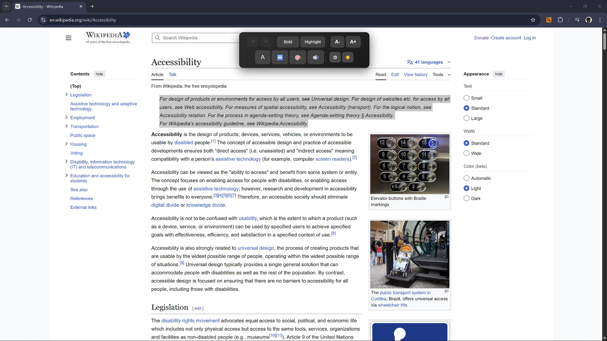

# Accessibility Text Enhancer

**Read the web on your terms.**

## Overview

Accessibility Text Enhancer is a Chrome extension that lets you adjust text while you read it. Select a passage and a small toolbar appears with one-click fixes for common readability problems: bold, highlight, font size, font style, letter and word spacing, contrast, and read aloud.

Unlike audit tools that only report problems, this extension applies the fix immediately, in your browser. There is no account and no build step. Text changes are local and can be undone. Translation uses Chrome's built-in, on-device Translator API: the extension sends no page text anywhere, though Chrome downloads a language pack the first time you use a pair.

Originally developed for an MSc dissertation at Solent University, it is now maintained by [Octavio Silva](https://github.com/FrankenSama).

## Features

- **Bold** and **highlight** just the selected words
- **Font size, contrast, and font choice** for the nearest paragraph: Sans, Serif, Monospace, or the bundled **OpenDyslexic** font
- **Text spacing** with Comfortable, the WCAG 1.4.12 preset, or four custom sliders, plus **highlight colour and style** (background, underline, or automatic contrast-aware)
- **Focus mode and reading ruler**: dim everything except the paragraph you are reading, or lay a translucent ruler under the pointer or caret. Both are visual, session-only aids that change nothing on the page. The dim strength and whether the ruler follows the pointer or caret are in Settings
- **Translate** the selection in place, or the paragraph on Shift-click, with Chrome's built-in Translator API. The translated text stays in the page, is marked with a dotted underline, and is restored by pressing Translate again, Undo, or Reset page. The target language syncs with your profile and can be changed in Settings. Needs Chrome 138+ on desktop and an HTTPS page
- **Read aloud** with selectable voice, speed, and pitch, sentence highlighting, auto-scroll, sentence navigation, pause/resume/stop controls, plus voice preview and a dedicated settings page. A caret continues to the end of the article; Shift-click or `Alt+Shift+C` continues from a selection
- **Reading presets**: Comfortable, Dyslexia-friendly, Low vision, and Focus set the font, spacing, highlight, and reading aids used next
- **Undo/redo** for the last 50 changes, plus **Reset page** to remove everything in one action
- **Saved text defaults** for font, spacing, and highlight that sync with your Chrome profile
- **Dark/light toolbar**, with JSON export/import (schema 5; older files still import), synced preferences, and per-site on/off rules
- **High contrast**: the toolbar, popup, and settings pages follow Windows High Contrast / forced-colors
- **Keyboard and screen reader support**: shortcuts, a single tab stop, arrow-key navigation, and `aria-pressed` state (NVDA-verified on Windows)
- **Works in** Chrome 91+ and other Chromium-based browsers; translation needs Chrome 138+ on desktop

## Install

**[Install from the Chrome Web Store](https://chromewebstore.google.com/detail/cgpanifaahogfainpnkebmbgemodgfli)** (recommended)
The store listing may lag the latest GitHub release; the [release zip](https://github.com/FrankenSama/Accessibility-Text-Enhancer/releases/latest) is the newest build.

To load it manually, clone this repository, open `chrome://extensions/`, turn on **Developer mode**, click **Load unpacked**, and select the project folder.

## Usage

1. Select text on any standard web page.
2. Use the toolbar that appears, or one of the shortcuts below.
3. Undo with `Ctrl+Z` / `Cmd+Z` if a change is not right.

The toolbar opens next to your selection, above it when there is room and below it otherwise, and always stays inside the viewport. Its ✕ button dismisses the toolbar without clearing the page selection, as does `Escape`; `Ctrl+Shift+F` (`Cmd+Shift+F`) brings it back for the same text.

### Toolbar at a glance

The symbols match the toolbar buttons:

| Symbol | Action | What it does |
|---|---|---|
| ↶ / ↷ | Undo / Redo | Steps through the last 50 changes on this page. |
| **Bold** | Bold | Bolds the selected words; Shift-click applies it to the whole paragraph. |
| **Highlight** | Highlight | Paints or outlines the selection with the saved colour and style; Shift-click applies it to the paragraph. |
| `A-` / `A+` | Decrease / increase size | Changes the paragraph font size by 2 px; Shift-click changes only the selection. |
| `A` | Font | Applies the saved font (Sans, Serif, Monospace, or OpenDyslexic) to the paragraph. A second press restores the page font. |
| ↔️ | Text spacing | Applies the saved spacing preset (Comfortable, WCAG 1.4.12, or Custom). A second press removes it. |
| 🎨 | Fix contrast | Adjusts the paragraph text colour until it is readable against its background. |
| 🎯 | Focus mode | Dims every block except the one under the selection or caret. Session-only; `Escape` exits. |
| 📏 | Reading ruler | Shows a translucent band under the pointer or caret to keep your place. Session-only; `Escape` exits. |
| 文A / ↺ | Translate / Show original | Replaces the selected text with its translation in place; Shift-click translates the paragraph, and pressing the button again restores the original. Needs Chrome 138+ desktop on an HTTPS page. |
| 🔊 | Read Aloud | Reads the selection; a caret continues to the end of the article. Shift-click continues from a selection. Turns into pause/resume while reading. |
| ⏹️ | Stop Reading | Stops speech; appears only while reading. |
| ⚙️ | Settings | Opens the in-page dialog for text styling, reading, site rules, page reset, and backup. |
| ☀️ / 🌙 | Toggle theme | Switches the toolbar and dialog between dark and light. |
| ✕ | Dismiss | Closes the toolbar; if a reading aid is active, it turns the aids off too. |

The popup's **This site** menu can keep the extension **Always on** or **Always off** for the current site. A site rule wins over the global switch, and the toolbar shows an `OFF` badge on sites you turned off. **Settings** (⚙️) in the toolbar lists every site rule with a remove button and a two-step clear-all action; the popup keeps the global switch and the rule for the current site. To undo the extension's changes to the current page, choose **Reset page changes** in the toolbar's settings dialog — the button asks for a second click — which removes every change and clears the undo history, leaving the page as it was found.

Theme, reading preferences, text styling, reading-aid settings, the translation target, and site rules are stored with `chrome.storage.sync`, so they follow your Chrome profile to other devices signed in to the same account. The on/off switch itself stays on this device.

The shortcuts below cover the toolbar and extension actions:

| Action | Windows/Linux | macOS |
|---|---|---|
| Open extension | `Ctrl+Shift+Y` | `Cmd+Shift+Y` |
| Toggle extension | `Ctrl+Shift+E` | `Cmd+Shift+E` |
| Focus toolbar | `Ctrl+Shift+F` | `Cmd+Shift+F` |
| Bold | `Alt+Shift+B` | `Option+Shift+B` |
| Highlight | `Alt+Shift+H` | `Option+Shift+H` |
| Read selection or paragraph | `Alt+Shift+R` | `Option+Shift+R` |
| Continue reading from here | `Alt+Shift+C` | `Option+Shift+C` |
| Next / previous sentence while reading | `Alt+Shift+Right` / `Alt+Shift+Left` | `Option+Shift+Right` / `Option+Shift+Left` |
| Pause / resume reading | `Space` | `Space` |
| Translate selection | `Alt+Shift+G` | `Option+Shift+G` |
| Focus mode | `Alt+Shift+D` | `Option+Shift+D` |
| Reading ruler | `Alt+Shift+L` | `Option+Shift+L` |
| Undo / redo | `Ctrl+Z` / `Ctrl+Y` | `Cmd+Z` / `Cmd+Y` |

Focus Toolbar can be rebound at `chrome://extensions/shortcuts` (also linked from the popup). Bold, highlight, read aloud, translate, focus mode, and the reading ruler are ignored in inputs, text areas, and editable regions. Undo and redo are only captured while the toolbar is visible and there is a change to undo. On Windows, `Alt+Shift` is also the default layout-switch shortcut; if it conflicts, use the toolbar buttons or rebind Focus Toolbar.

Screen-reader announcements are verified with NVDA on Windows. VoiceOver on macOS and Orca on Linux have not been tested; see [`docs/smoke-test.md`](docs/smoke-test.md) for the manual checklist and current coverage. [ACCESSIBILITY.md](ACCESSIBILITY.md) lists supported environments, known limitations, and how to report a barrier.

## Privacy

Preferences, the translation target, and site rules are stored with `chrome.storage.sync`, so Chrome may sync them across the devices signed in to your Google account; the on/off switch uses `chrome.storage.local` and stays on this device. Selections and page content are processed in your browser and never sent to the developer or a third party. The translated text replaces the selection locally and can be undone. Translation runs through Chrome's built-in Translator API; the first use of a language pair downloads an on-device language pack, and the extension sends no page text to the developer or any third party. See the [privacy policy](privacy-policy.md) for details.

## Contributing

This is a personal project, free software under the GNU GPLv3. Bug reports and focused pull requests are appreciated; reviews happen at the maintainer's discretion. Start with [CONTRIBUTING.md](CONTRIBUTING.md) for the quick setup and pull-request checklist; deeper architecture, testing, and release notes are in [docs/development.md](docs/development.md). [ROADMAP.md](ROADMAP.md) lists planned work. Accessibility barriers can be reported through the dedicated issue template; security problems should follow [SECURITY.md](SECURITY.md) rather than a public issue.

## License

[GNU General Public License v3.0 (only)](LICENSE) © 2025–2026 Octavio Silva. This is free software: you can redistribute it and/or modify it under version 3 of the GPL as published by the Free Software Foundation. It is distributed in the hope that it will be useful, but without any warranty. If you fork or republish, keep the license and copyright notice, publish your source under the same license, credit the original author, and make it clear that your version is not official. Releases published before the license change remain available under MIT; the current and future versions are GPLv3.

## Bundled font

OpenDyslexic is © Abbie Gonzalez and is distributed under the [SIL Open Font License 1.1](fonts/OFL.txt). The extension ships the unmodified regular and bold WOFF2 files with the full licence text in `fonts/`. The font remains under the OFL and is not covered by the GPL.

---

[GitHub](https://github.com/FrankenSama/accessibility-text-enhancer) · [Project page](https://frankensama.github.io/Accessibility-Text-Enhancer/) · [Accessibility](ACCESSIBILITY.md) · [LinkedIn](https://www.linkedin.com/in/octavio-silva-designer/) · [Report an issue](https://github.com/FrankenSama/accessibility-text-enhancer/issues)
