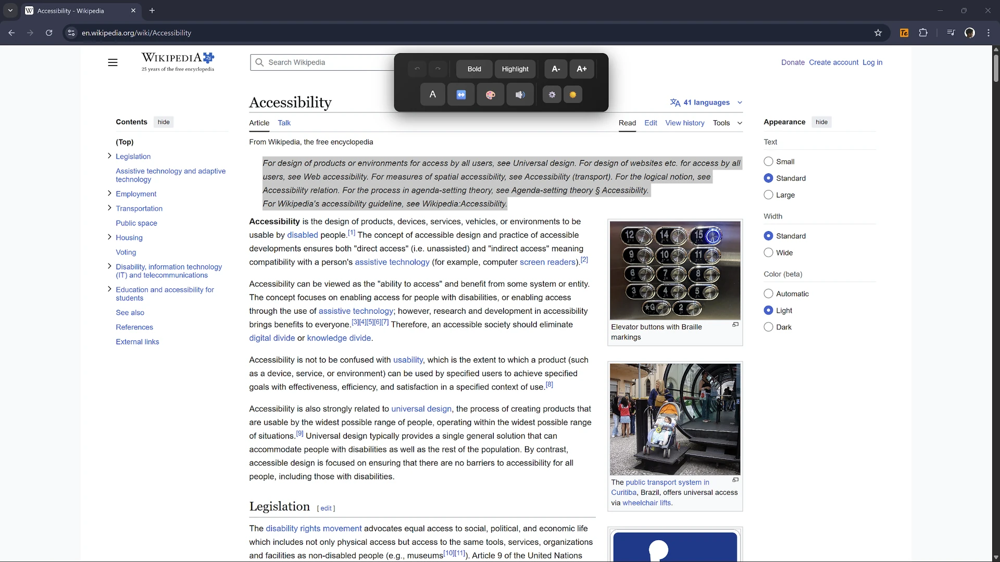

# Accessibility Text Enhancer

<div align="center">


**A real-time, user-driven browser extension for web accessibility enhancement**




</div>

---

## 🌟 Overview

Accessibility Text Enhancer is a browser extension that empowers users to take control of web accessibility in real-time. Unlike traditional tools that only identify problems, this extension provides immediate, client-side remediation of common accessibility barriers—putting solutions directly in users' hands.

Originally developed as part of an MSc Computer Engineering dissertation at Solent University, it is now maintained as a personal project by Octavio Silva. It bridges the critical gap between **identifying** accessibility issues and **fixing** them.

### The Problem

Despite established WCAG guidelines, **96% of websites fail basic accessibility compliance** (WebAIM, 2023). Existing tools like Lighthouse and axe-core excel at diagnostics but leave users waiting for developers to implement fixes—a process that can take weeks, months, or may never happen.

### What It Does

A user-centric, real-time accessibility enhancement tool that:
- ✅ Provides **instant fixes** without requiring developer intervention
- ✅ Works on standard web pages (browser-internal pages such as `chrome://` and the Chrome Web Store are excluded)
- ✅ Operates **client-side** with no network round-trips, so page content stays in your browser
- ✅ Empowers users with **immediate agency** over their browsing experience

---

## ✨ Features

### 🎨 Text Enhancement Suite

| Feature | Description |
|---------|-------------|
| **Bold Toggle** | Make just the selected words bold; Shift-click applies to the whole paragraph |
| **Highlight** | Highlight just the selection with a yellow background or outline; Shift-click applies to the paragraph |
| **Font Size** | Resize the paragraph around the selection (8-50px); Shift-click targets only the selection |
| **Font Style** | Switch the paragraph between sans-serif and serif; Shift-click targets only the selection |
| **Text Spacing** | Adjust the paragraph's letter and word spacing; Shift-click targets only the selection |
| **Contrast Fix** | Choose black or white text for the paragraph based on its background; Shift-click targets only the selection |
| **Read Aloud** | Text-to-speech for selected content |

### 🚀 Advanced Capabilities

- **Undo/Redo System**: Undo history for the last 50 changes with `Ctrl+Z` / `Ctrl+Y` while the toolbar is open
- **Persistent Theme**: Remember your dark/light toolbar preference
- **Dark/Light Mode**: Toggle toolbar theme to match your preference
- **Export/Import**: Back up or restore your toolbar theme as JSON
- **Keyboard Shortcuts**: Shortcuts for the most common actions, plus a single-tab-stop toolbar with arrow-key navigation
- **Screen Reader Support**: Toggle state is announced with `aria-pressed`, including mixed selections
- **Real-time Performance**: < 5ms enhancement execution time

### 💾 Personalization

- Remember your toolbar theme between sessions
- Export the theme preference as JSON for backup
- Import it on another device

---

## 📦 Installation

### Chrome Web Store (Recommended)
[Link](https://chromewebstore.google.com/detail/cgpanifaahogfainpnkebmbgemodgfli)

### Manual Installation (Developer Mode)

1. **Clone the repository**
   ```bash
   git clone https://github.com/FrankenSama/accessibility-text-enhancer.git
   cd accessibility-text-enhancer
   ```

2. **Load in Chrome**
   - Open Chrome and navigate to `chrome://extensions/`
   - Enable "Developer mode" (toggle in top-right)
   - Click "Load unpacked"
   - Select the project directory

3. **Verify Installation**
   - The extension icon should appear in your toolbar
   - Click it to see the popup interface

---

## 🎯 Usage

### Basic Usage

1. **Select Text**: Highlight text on most webpages
2. **Toolbar Appears**: The accessibility toolbar will appear at the top of your screen
3. **Apply Enhancements**: Click any button to enhance the selected text
4. **Undo if Needed**: Use the undo button or `Ctrl+Z` to revert changes

### Selection Scope

Bold and Highlight change only the words you selected. Font size, font style, text spacing, and contrast change the nearest paragraph or block, because those adjustments only read well when the whole block moves together.

- **Shift-click flips the scope**: Bold/Highlight apply to the paragraph, while the readability buttons apply only to the selected text.
- If a selection crosses several paragraphs, Bold and Highlight fall back to each paragraph and a toast explains what happened.
- One undo step restores every element changed by a single action.

### Keyboard Shortcuts

Keyboard shortcuts are available for the most common actions:

| Action | Windows/Linux | macOS |
|--------|---------------|-------|
| Open Extension | `Ctrl+Shift+Y` | `Cmd+Shift+Y` |
| Toggle Extension | `Ctrl+Shift+E` | `Cmd+Shift+E` |
| Focus Toolbar | `Ctrl+Shift+F` | `Cmd+Shift+F` |
| Bold Text | `Alt+Shift+B` | `Option+Shift+B` |
| Highlight Text | `Alt+Shift+H` | `Option+Shift+H` |
| Undo | `Ctrl+Z` | `Cmd+Z` |
| Redo | `Ctrl+Y` | `Cmd+Y` |

> With the toolbar focused, `ArrowLeft`/`ArrowRight` move between commands and `Home`/`End` jump to the first or last one. Undo/redo shortcuts are only captured while the accessibility toolbar is visible and the extension has a step to undo or redo, so native text editing and page-level undo keep working. `Alt+Shift+B/H` are ignored inside text fields and editable regions.
>
> Focus Toolbar is a Chrome command, so you can rebind it at `chrome://extensions/shortcuts` (also linked from the popup). Chrome handles it before the page, so it takes precedence over any site shortcut with the same combination; rebind it if that is a problem. Bold and Highlight only act on a text selection and are ignored inside inputs, text areas, selects, and editable regions.
>
> On Windows, `Alt+Shift` is also the default keyboard-layout switch. If that interferes, use the rebindable Focus Toolbar command and the toolbar buttons instead.
>
> Chrome reserves `Alt+Shift+A` (focus inactive dialogs), `Ctrl+Shift+A` (tab search), `Ctrl+Shift+B` (bookmarks bar), `Alt+Shift+T` (focus browser toolbar), and `Cmd+Shift+H` (home page on macOS). `Ctrl+Shift+Y`, `Ctrl+Shift+E`, and `Ctrl+Shift+F` are not Chrome defaults, but another extension may already own one; Chrome then leaves ours unassigned, and you can rebind or reset it at `chrome://extensions/shortcuts`. If you installed an earlier build, Chrome may keep the previous shortcut there too.

### Settings Panel

Open the settings panel with the ⚙️ button in the toolbar:

- **Export Settings**: Download your toolbar theme preference as JSON
- **Import Settings**: Restore a previously exported theme preference

---

## 🔬 Research Background

This extension was developed as part of a Master's dissertation titled:

> **"A User-Driven Browser Extension for Real-Time Web Accessibility Enhancement"**  
> *Octavio Silva, MSc Computer Engineering*  
> *Solent University, 2024-2025*

### Key Research Findings

**Performance Metrics** (tested on 20 diverse websites):
- ✅ **100% toolbar availability** on standard web pages (browser-restricted pages excluded)
- ✅ **95%+ success rate** for core enhancement features
- ✅ **< 2.5MB memory** overhead per tab
- ✅ **< 3% CPU** increase during enhancement
- ✅ **< 5ms execution** time for all enhancements

**Tested Environments**:
- News websites (BBC, The Guardian)
- E-commerce (Amazon, eBay)
- Social media (Twitter/X, Reddit)
- SPAs (Google Docs, YouTube)
- Government sites (GOV.UK)

### Research Questions Addressed

**RQ1**: *Can a browser extension provide effective, real-time remediation for perceptual accessibility issues?*

✅ **Answer**: Yes. The extension successfully applies CSS overrides with `!important` flags, achieving broad compatibility across diverse DOM structures with minimal performance impact.

**RQ2**: *What is the performance impact of real-time, client-side accessibility enhancement?*

✅ **Answer**: Negligible. Memory overhead averages 2.5MB per tab with CPU spikes < 3% during enhancement execution and no sustained load.

### Academic Citations

If you use this tool in research, please cite:

```bibtex
@mastersthesis{silva2025accessibility,
  author = {Silva, Octavio},
  title = {A User-Driven Browser Extension for Real-Time Web Accessibility Enhancement},
  school = {Solent University},
  year = {2025},
  type = {MSc Dissertation},
  note = {COM726 - Computer Engineering}
}
```

---

## 🏗️ Technical Architecture

### Technology Stack

- **Manifest V3**: Modern Chrome Extension API
- **Vanilla JavaScript (ES6+)**: Zero dependencies for maximum compatibility
- **CSS3**: Advanced styling with Flexbox
- **Chrome Storage API**: Persistent theme and enabled state
- **Web Speech API**: Text-to-speech functionality

### Project Structure

```
accessibility-text-enhancer/
├── manifest.json              # Extension configuration
├── background.js              # Service worker for shortcuts & badge
├── popup/
│   ├── popup.html            # Extension popup interface
│   ├── popup.css             # Popup styling
│   └── popup.js              # Popup logic
├── content-scripts/
│   ├── content.js            # Main enhancement engine
│   └── content.css           # Toolbar styling
├── icons/                    # Extension icons (16, 48, 128px)
├── docs/                     # Documentation & research papers
├── index.html                # GitHub Pages landing page
├── styles.css                # Landing page styling
├── script.js                 # Landing page interactions
├── ROADMAP.md                # Planned accessibility work
├── privacy-policy.md         # Privacy policy
└── README.md                 # This file
```

### Architecture Diagram

```
┌─────────────────┐
│   User Action   │
│ (Text Selection)│
└────────┬────────┘
         │
         ▼
┌─────────────────────────────────┐
│   Content Script (content.js)   │
│  ┌──────────────────────────┐  │
│  │  Selection Event Handler  │  │
│  └────────┬─────────────────┘  │
│           │                     │
│           ▼                     │
│  ┌──────────────────────────┐  │
│  │   Toolbar Creation        │  │
│  │   & Positioning           │  │
│  └────────┬─────────────────┘  │
│           │                     │
│           ▼                     │
│  ┌──────────────────────────┐  │
│  │  Command Execution        │  │
│  │  - Bold / Highlight       │  │
│  │  - Size / Spacing         │  │
│  │  - Contrast / TTS         │  │
│  └────────┬─────────────────┘  │
│           │                     │
│           ▼                     │
│  ┌──────────────────────────┐  │
│  │   DOM Manipulation        │  │
│  │   (CSS Injection)         │  │
│  └────────┬─────────────────┘  │
│           │                     │
│           ▼                     │
│  ┌──────────────────────────┐  │
│  │   History Management      │  │
│  │   (Undo/Redo Stack)       │  │
│  └──────────────────────────┘  │
└─────────────────────────────────┘
         │
         ▼
┌─────────────────┐
│  Chrome Storage │
│  (Persistence)  │
└─────────────────┘
```

### Key Design Decisions

1. **Parent Element Modification**: Modifies parent containers rather than wrapping selected text, trading surgical precision for robustness across diverse sites

2. **`!important` CSS Flags**: Ensures accessibility enhancements override existing styles regardless of specificity

3. **Client-Side Processing**: All operations occur in-browser—no server calls or network round-trips

4. **Fixed Toolbar Position**: Positioned at viewport top to prevent interference with text selection

---

## 🎓 Development

### Prerequisites

- Chrome/Chromium browser (v88+)
- Basic understanding of Chrome Extension APIs
- Text editor (VS Code recommended)

### Setup Development Environment

```bash
# Clone repository
git clone https://github.com/FrankenSama/accessibility-text-enhancer.git

# Navigate to directory
cd accessibility-text-enhancer

# Load in Chrome (chrome://extensions/)
# Enable Developer Mode → Load Unpacked → Select directory
```

### Debugging

1. **Content Script**: Right-click page → Inspect → Console tab
2. **Popup**: Right-click extension icon → Inspect popup
3. **Background Script**: chrome://extensions/ → Details → Inspect views

---

## 🗺️ Roadmap

Planned accessibility work is tracked in [ROADMAP.md](ROADMAP.md). Phase 1 (v1.2.0) covers toolbar semantics and keyboard access; later phases cover the reading assistant, per-site preferences, reading aids, and platform support.

## 🌱 Forks & Contributions

This is a personal project maintained by Octavio Silva. Forks are welcome under the MIT License. Bug reports and focused pull requests are appreciated, but reviews and merges happen at the maintainer's discretion — there is no guaranteed response time.

### Sending a Pull Request

1. **Fork the repository**
2. **Create a feature branch** (`git checkout -b feature/AmazingFeature`)
3. **Commit your changes** (`git commit -m 'Add some AmazingFeature'`)
4. **Push to the branch** (`git push origin feature/AmazingFeature`)
5. **Open a Pull Request**

### Guidelines

- Follow existing code style and conventions
- Add comments for complex logic
- Update README.md if adding new features
- Test on multiple websites before submitting
- Ensure accessibility of any new UI elements

### Ideas for Forks

- 🎨 **UI/UX Design**: Improve toolbar aesthetics
- 🧪 **Testing**: Cross-browser compatibility testing
- 📝 **Documentation**: Improve guides and examples
- 🌍 **Localization**: Translations for international users
- ♿ **Accessibility**: User testing with screen readers

---

### Compatibility
Tested and verified on:
- ✅ Chrome 88+
- ✅ Edge 88+
- ✅ Brave 1.20+
- ✅ Opera 74+

---

## 📄 License & Attribution

This project is licensed under the [MIT License](LICENSE).  
Copyright (c) 2025-2026 Octavio Silva.

### Forking & Attribution

You are welcome to fork, modify, and publish your own version under the MIT License. If you do, please:

1. **Keep the license** — include the `LICENSE` file and copyright notice in your fork. This is required by the MIT License.
2. **Credit the original** — mention Octavio Silva and link back to this repository in your README or about page. The link-back is a courtesy request; MIT's legal requirement is the copyright and permission notice.
3. **Don't imply it's official** — make it clear that your fork is not the official Accessibility Text Enhancer, and don't use the project name or icon in a way that suggests it is.

Using GitHub's **Fork** button automatically preserves the license and adds a visible "forked from" link back to this repository.

---

## 🙏 Acknowledgments

- **Solent University** - Academic support and research facilities
- **Bacha Rehman** - Module leader and dissertation supervisor
- **WebAIM** - Accessibility research and testing resources
- **W3C** - WCAG guidelines and standards
- **Chrome Extensions Team** - Excellent documentation and APIs

### Research References

This project builds upon:

1. **WebAIM** (2023). *The WebAIM Million*. https://webaim.org/projects/million/
2. **W3C** (2023). *WCAG 2.2 Guidelines*. https://www.w3.org/TR/WCAG22/
3. **Deque Systems** (2023). *axe-core Documentation*. https://github.com/dequelabs/axe-core
4. **Google** (2023). *Lighthouse Accessibility Auditing*. https://developer.chrome.com/docs/lighthouse/

---

## 📞 Contact & Support

### Author
**Octavio Silva**  
MSc Computer Engineering  
Solent University

### Links
- 🐙 **GitHub**: [@FrankenSama](https://github.com/FrankenSama)
- 🌐 **LinkedIn**: https://www.linkedin.com/in/octavio-silva-designer/
- 🌐 **Project Page**: https://frankensama.github.io/accessibility-text-enhancer/

### Reporting Issues

Found a bug or have a feature request?

1. Check existing [issues](https://github.com/FrankenSama/accessibility-text-enhancer/issues)
2. Create a new issue with:
   - Clear description
   - Steps to reproduce (for bugs)
   - Expected vs actual behavior
   - Browser version and OS

---

<div align="center">

**Making the web accessible, one selection at a time** ♿

[⬆ Back to Top](#accessibility-text-enhancer)


</div>


